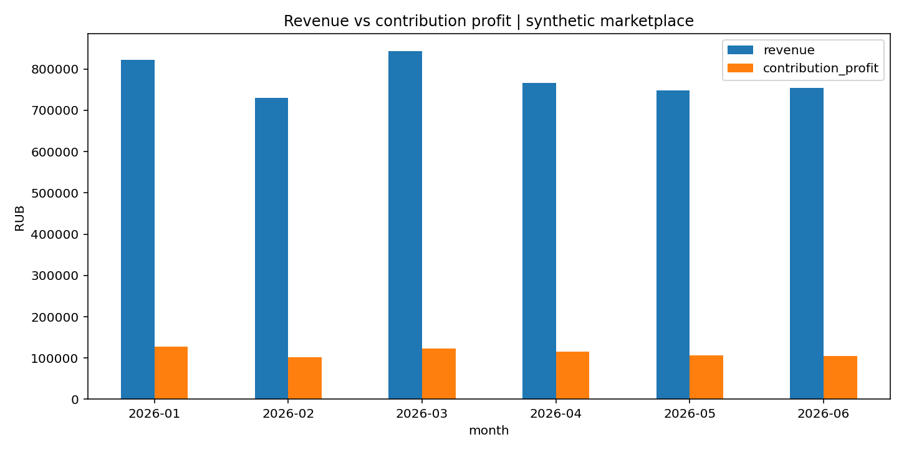

# Анализ продаж на Python / pandas

## Вопрос

Какие месяцы и категории обеспечивают основной маржинальный доход продавца и какова доля возвращённых заказов?

**Данные:** учебные синтетические заказы из проекта [01](../01_marketplace_sql/README.md), не реальные данные Wildberries.

**Инструменты:** `pandas`, `matplotlib`; группировки `groupby`, очистка и валидация, вычисляемые поля, визуализация, бизнес-выводы.

## Запуск

Из корня репозитория: `python 02_sales_python/analyze_sales.py`

Выполненный код сохраняет [короткий отчёт](report.md) и два графика — [месячную динамику](charts/monthly.png) и [категории](charts/categories.png).

## Ограничения

Contribution profit — выручка минус перечисленные переменные расходы по доставленным заказам; это **не** итоговая чистая прибыль бизнеса. Для практического решения потребуются фиксированные расходы, реальные тарифы, корректные возвраты, сезонность и статистическая проверка изменений.
