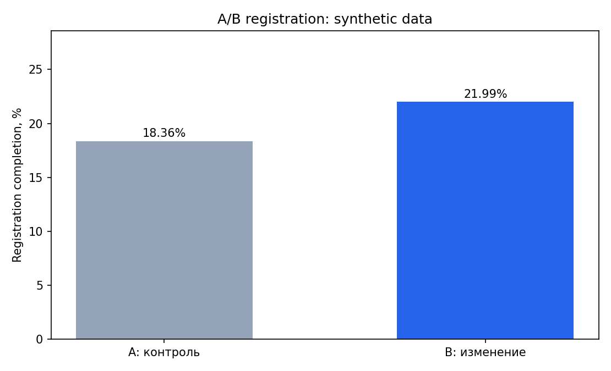

# A/B-тест регистрации: оценка изменения конверсии

## Продуктовая задача

Продуктовая команда упростила форму регистрации. Проверяем, выросла ли вероятность **успешного завершения** регистрации после назначения пользователя в вариант B.

- **H0:** p(B) = p(A); **H1:** p(B) ≠ p(A) (двусторонняя проверка).
- **Основная метрика:** доля пользователей, завершивших регистрацию среди всех рандомизированных пользователей (ITT).
- **Вторичная метрика:** доля начавших регистрацию.
- **Альфа:** 0.05; 95% доверительный интервал разницы долей (нормальное приближение).
- **Проверка качества:** Sample Ratio Mismatch через z-проверку 50/50, уникальность пользователей, корректность этапов воронки.

**Важно:** данные **синтетические**, а эффект намеренно внесён генератором. Это пример расчёта и интерпретации, **не доказательство эффективности реального продукта**. Размер выборки не рассчитывался заранее, поэтому практическое решение без предварительного power analysis было бы некорректным.

## Запуск

`python 03_ab_test/generate_experiment.py` — воспроизводимая генерация с фиксированным seed.

`python 03_ab_test/analyze_experiment.py` — анализ и [`report.md`](report.md).

## Что я проверяю перед внедрением

SRM, корректность рандомизации, изменение guardrail-метрик (время, ошибки), длительность эксперимента, влияние сезонности и множественных сравнений. Статистически значимый результат сам по себе ещё не гарантирует бизнес-эффект.
