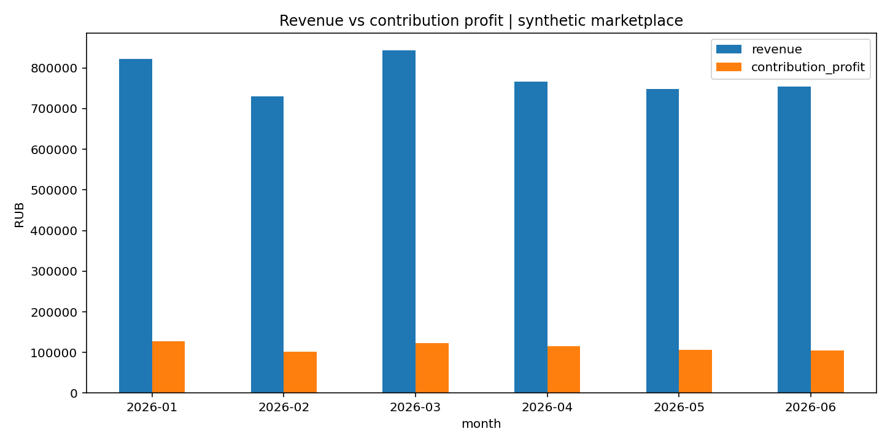

# Портфолио IT аналитика

**SQL · Python · Pandas · Визуализация · Продуктовые метрики · A/B-тесты**

> **Важно:** все исходные наборы данных в репозитории **синтетические, специально сгенерированные для учебных проектов**. Они не являются выгрузками реального бизнеса. Результаты и цифры ниже относятся только к этим данным.

## Проекты

| Проект | Задача бизнеса | Инструменты | Что посмотреть |
|---|---|---|---|
| **[01. Аналитика заказов маркетплейса](01_marketplace_sql/README.md)** | Выручка, прибыль, ABC-анализ, повторные клиенты, когорты | SQL (CTE, JOIN, оконные функции), SQLite / PostgreSQL-совместимые запросы | [SQL-запросы](01_marketplace_sql/sql), [таблицы с результатами](01_marketplace_sql/results) |
| **[02. Анализ продаж на Python](02_sales_python/README.md)** | Динамика продаж, прибыльность, категории и проблемные зоны | Python, pandas, matplotlib | [Код](02_sales_python/analyze_sales.py), [отчёт](02_sales_python/report.md) |
| **[03. A/B-тест регистрации](03_ab_test/README.md)** | Проверить, повысило ли изменение конверсию в завершение регистрации | Python, статистика, доверительный интервал, z-тест | [Код](03_ab_test/analyze_experiment.py), [результаты](03_ab_test/report.md) |

## Быстрый запуск

```bash
python -m venv .venv
source .venv/bin/activate     # Windows: .venv\Scripts\activate
pip install -r requirements.txt
python 01_marketplace_sql/run_sql.py
python 02_sales_python/analyze_sales.py
python 03_ab_test/analyze_experiment.py
```

SQL-проект использует стандартную библиотеку Python и SQLite, поэтому его можно запустить **без установки СУБД**. Запросы избегают диалектных функций и используют конструкции, поддерживаемые также PostgreSQL. Для PostgreSQL сначала импортируйте CSV и задайте подходящие типы столбцов.

## Пример результатов на синтетических данных

- SQL: 3 200 сгенерированных заказов, из них 2 698 доставлено; contribution margin **14,53%** в рамках упрощённой модели.
- Python: [график динамики выручки и маржинального дохода](02_sales_python/charts/monthly.png), [прибыльность по категориям](02_sales_python/charts/categories.png).
- A/B-тест: конверсия **18,36%** в группе A против **21,99%** в B, разница **+3,63 п.п.**; статистический расчёт и ограничения в [отчёте](03_ab_test/report.md).



*Приведённые цифры получены только на учебных искусственных данных и не описывают финансовые результаты реального бизнеса.*
